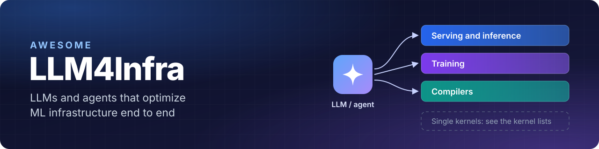

   

Papers and reports in which **LLMs and LLM-based agents optimize machine-learning infrastructure end to end**: 
serving engines, training frameworks, ML compilers, and the configuration and communication around them.

## 📚 Contents

| | Section | What it covers | Entries |
|:---:|:---|:---|:---:|
| 🚀 | [Serving and inference](#-serving-and-inference) | Agents that change, configure or build inference engines and serving systems. | 20 |
| 🧠 | [Training](#-training) | Agents that tune or build training and post-training systems. | 6 |
| 🧩 | [Compilers](#-compilers) | LLM-guided compiler optimization and compiler-agent co-design, evaluated at graph or model level. | 6 |
| 🧪 | [Benchmarks](#-benchmarks) | Benchmarks and environments that measure LLMs and agents on ML-infrastructure tasks. | 8 |
| 🧭 | [General methods with ML-infrastructure results](#-general-methods-with-ml-infrastructure-results) | General LLM-driven optimization methods that report results on ML infrastructure. | 5 |

Also: [🔥 Most recent](#-most-recent) · [🔗 Related lists](#-related-lists) · [🤝 Contributing](#-contributing)

## 📌 Scope

✅ **Included:** an LLM or an LLM-based agent does the optimizing, and the thing optimized or evaluated sits above a single kernel: end-to-end inference or training performance, serving and training frameworks, ML compilers, configuration for ML workloads, and benchmarks for these tasks. Kernel work is included when its gain is measured end to end in a real framework.

❌ **Not included:** single-kernel generation and optimization (see the [related lists](#-related-lists)), infrastructure built for agents, ML systems designed without an LLM in the loop, and general software or systems optimization that does not target ML infrastructure. [CONTRIBUTING.md](CONTRIBUTING.md) has the full rule.

> [!NOTE]
> Results are quoted as each paper's authors report them. Settings differ, so numbers are not comparable across entries.

## 🔥 Most recent

| Date | Work | Section |
|:---:|:---|:---|
| 2026‑10‑13 | [ATTUNE: Agentic Throughput Tuning for LLM Training](https://arxiv.org/abs/2610.17528) | [🧠 Training](#-training) |
| 2026‑10‑03 | [SEIS: Self-Evolving Inference Systems](https://arxiv.org/abs/2610.04646) | [🚀 Serving and inference](#-serving-and-inference) |
| 2026‑10‑02 | [Agentic inference optimization: 50-90% faster engines](https://www.baseten.co/blog/agentic-inference-optimization-faster-than-sota/) | [🚀 Serving and inference](#-serving-and-inference) |
| 2026‑09‑30 | [Herschel: Continuous Optimization of Production LLM Inference through On-Demand Profiling](https://arxiv.org/abs/2609.40247) | [🚀 Serving and inference](#-serving-and-inference) |
| 2026‑09‑28 | [Sol-H3: Recursive Self-Improvement for MiniMax-H3 Inference Acceleration on Sol-Engine across Cloud and Edge](https://arxiv.org/abs/2609.35110) | [🚀 Serving and inference](#-serving-and-inference) |

## 🚀 Serving and inference

Agents that change, configure or build inference engines and serving systems. 20 entries, newest first.

- **[SEIS: Self-Evolving Inference Systems](https://arxiv.org/abs/2610.04646)** 
    
  Zhen Xu, Jingyu Liu, Zongze Li et al. · Oct 2026 
  An agent optimizes the whole mini-sglang engine without human intervention over repeated sessions that inherit earlier code changes and experience; correctness is checked by numerical difference and downstream accuracy. 
  📈 **Reported:** Serving Qwen3-0.6B on an H100, the evolved engine reaches 3.27x the throughput of the original mini-sglang and beats vLLM, TensorRT-LLM and SGLang on the single-request workload.

- **[Agentic inference optimization: 50-90% faster engines](https://www.baseten.co/blog/agentic-inference-optimization-faster-than-sota/)** 
   
  Shawn Rushefsky · Oct 2026 
  At Baseten, Claude Code with Fable 5, using MetaInfer skills, built and iterated an inference engine for Qwen-3.6-35B-A3B in NVFP4 on one B200. 
  📈 **Reported:** Against a well-tuned vLLM 0.25.1, up to 90% faster single-stream decode on speculator-friendly text and 2.33x faster time to first token (12 ms against 28 ms).

- **[Herschel: Continuous Optimization of Production LLM Inference through On-Demand Profiling](https://arxiv.org/abs/2609.40247)** 
   
  Luping Wang, Weigao Chen, Yifei Wu et al. · Sep 2026 
  A production system for continuous LLM-inference optimization: on-demand profiling of running serving processes finds inefficiencies, and AI agents implement and test engine and kernel changes under the triggering workload, with expert review before deployment. 
  📈 **Reported:** Over six months it collected about 17,000 traces across more than 120 model variants and more than 10 accelerator types, finding inefficiency patterns in 23% of them; representative findings led to widely deployed optimizations.

- **[Sol-H3: Recursive Self-Improvement for MiniMax-H3 Inference Acceleration on Sol-Engine across Cloud and Edge](https://arxiv.org/abs/2609.35110)** 
    
  Yitong Li, Jincheng Yu, Junsong Chen et al. · Sep 2026 
  A full-stack inference pipeline for the MiniMax-H3 video model in which a recursive self-improvement agent loop searches kernel fusions and memory layouts, checking latency and numerical agreement, next to a human-designed two-stage generation scheduler. 
  📈 **Reported:** On a single DGX Spark the pipeline runs more than 30x faster than a full-resolution 49-step MiniMax-H3 baseline and uses about 20% less memory than a naive two-stage deployment; on an 8xGB200 node a 5-second 1344x768 video with audio is generated 3.5x faster than real time.

- **[An AlphaGo Moment for Inference?](https://int21.ai/insights/ai-generated-inference-engines/)** 
   
  INT21 · Sep 2026 
  INT21 reports AI-generated inference engines for 15 models, built by two engineers in two weeks, and compares them with SGLang and vLLM on the same workloads.

- **[Toward Recursive Self-Improvement: How GLM Built Its Own Inference Infrastructure](https://z.ai/blog/glm-built-its-inference-infrastructure)** 
   
  Z.ai · Sep 2026 
  Z.ai describes taking GLM-5.3-Flash from initial adaptation to production, with much of the engineering carried out by an Infra Agent powered by GLM-5.3 that ran a feedback loop through the optimization. 
  📈 **Reported:** End-to-end throughput roughly tripled relative to the initial baseline on a production cluster of more than 100,000 Chinese-made AI accelerators; the optimizations included mixed-precision cache quantization and an encode-prefill-decode disaggregated architecture.

- **[RoofLang: Enabling AI-Driven Architecting of LLM Inference Systems](https://arxiv.org/abs/2609.12551)** 
    
  Ziyue Yang, Yuting Jiang, Lei Qu, Peng Cheng · Sep 2026 
  A domain-specific language that describes LLM inference workloads with a verifiable mutation space and an implementation-independent evaluator, so an optimizer agent can search inference-system architectures instead of profiling one existing software stack. 
  📈 **Reported:** An optimizer agent found architectures that improve both throughput and interactivity of DeepSeek V4 Pro on NVIDIA B300 by 6.23-50.1%, according to RoofLang's evaluator.

- **[Meet Hanoi, our ultra-fast inference engine](https://autoloops.ai/case-studies/hanoi)** 
   
  Anirudh · Sep 2026 
  Claude Code wrote a from-scratch inference engine for Gemma 4 26B, about 36,000 lines of C++ and CUDA covering tokenizer, weight format, kernels, scheduler and HTTP server, without hand edits. 
  📈 **Reported:** Serving 400 concurrent voice calls on one L40S 48 GB with the same FP8 Gemma checkpoint and simulator flags, median time to first token was 71 ms against 105 ms for vLLM tuned with an FP8 KV cache and an 8,192-token prefill cap.

- **[LLM4LLM: Bridging Kernel Benchmarks and Real Deployment via Closed-Loop Agentic Optimization](https://arxiv.org/abs/2608.21836)** 
     
  Hui Zeng, Pengfei Yang, Yanxin Chen et al. · Aug 2026 
  Starting from a target inference script, an agent extracts phase-aware optimization tasks, searches for faster code using experience from earlier episodes, and accepts a patch only after validating it inside the running model. 
  📈 **Reported:** Improves end-to-end latency on all ten evaluated LLM inference workloads, with 3.91x and 6.98x geometric-mean speedups over eager PyTorch on A100 and H100.

- **[GEAK v4: From Faster Kernels to Faster Workloads](https://www.amd.com/en/developer/resources/technical-articles/2026/geak-v4.html)** 
    
  Zihao An, Yue Liu, Chao Xu et al. · Jul 2026 
  AMD's LLM kernel agents start from profiles of real serving workloads in vLLM and SGLang, optimize the kernels that dominate them, and measure the result as end-to-end serving throughput. 
  📈 **Reported:** End-to-end serving-throughput gains of 60% on Qwen3.5-27B-FP8 and 96% on Qwen3-14B-FP8 (MI300X, SGLang, TP1, 1K input and output, concurrency 64), and 42.2% on MiniMax-M3-MXFP8 (MI355X, vLLM).

- **[Automatic Model-Hardware Co-Adaptation for Heterogeneous AI Accelerators](https://arxiv.org/abs/2607.12875)** 
    
  Tian Chen, Mingheng Mi, Pu Wang et al. · Jul 2026 
  MetaInfer, an LLM-agent system, adapts new models to existing accelerators by searching routes through a graph that links model semantics, framework dispatch, kernel choices and hardware, repairing blocked routes with patches and validating them with end-to-end profiling; shown on DeepSeek V4 Flash and GLM 5.3 Flash on NVIDIA A800 and DeepSeek V4 Flash on a Hygon K100AI DCU.

- **[Agent-Assisted SGLang Development: An Initial Exploration](https://www.lmsys.org/blog/2026-07-02-agent-assisted-sglang-development/)** 
   
  SGLang Team · Jul 2026 
  SGLang maintainers describe how coding agents with SGLang-specific skills profile, patch and validate the engine in long-running loops, and list merged changes with their end-to-end measurements.

- **[Sol Video Inference Engine: Agent-Native Full-Stack Acceleration Framework for Efficient Video Generation](https://arxiv.org/abs/2606.23743)** 
    
  Yitong Li, Junsong Chen, Haopeng Li et al. · Jun 2026 
  Parallel skill agents optimize cache reuse, sparse attention, token pruning, quantization and kernel fusion for a given video diffusion model, hardware and serving configuration, and an integrator agent composes them into one acceleration stack, with a human checking generation quality. 
  📈 **Reported:** More than 2x end-to-end acceleration over the SGLang baseline on B200 GPUs, at near-lossless VBench quality, on Cosmos3-Super (64B), LTX-2.3 (22B) and SANA-Video (2B).

- **[KForge: LLM-Driven Cross-Platform Kernel Generation for AI Accelerators](https://arxiv.org/abs/2606.02963)** 
    
  Taras Sereda, Burak Bartan, Ankita Nayak et al. · Jun 2026 
  Two LLM agents generate kernels across accelerator backends: one writes and refines kernels from compiler and correctness feedback, the other reads profiling data and steers the next round. 
  📈 **Reported:** On an NVIDIA B200, its kernels raise end-to-end throughput by 2.12% over TensorRT-LLM on the gpt-oss-20b inference benchmark.

- **[From Human Guidance to Autonomy: Agent Skill System for End-to-End LLM Deployment on Spatial NPUs](https://arxiv.org/abs/2606.07586)** 
    
  Jiajie Li, Erwei Wang, Zhiru Zhang, Samuel Bayliss · May 2026 
  A reference deployment of Llama-3.2-1B on the AMD XDNA 2 NPU, built with human-guided agent assistance, is distilled into an eight-phase agent skill system that then deploys new LLMs end to end through the open-source compiler stack, with numerical-correctness gates at each phase. 
  📈 **Reported:** The reference deployment runs prefill 2.2x and decode 4.0x faster than the hand-optimized baseline; the skill system then deployed eight more decoder-only LLMs autonomously in 0.5 to 4 hours of agent time each.

- **[VibeServe: Can AI Agents Build Bespoke LLM Serving Systems?](https://arxiv.org/abs/2605.06068)** 
    
  Keisuke Kamahori, Shihang Li, Simon Peter, Baris Kasikci · May 2026 
  Coding agents generate a complete LLM serving stack for a given model, workload and hardware: an outer loop plans the search over system designs, and an inner loop implements each candidate, checks correctness and measures it on the target benchmark. 
  📈 **Reported:** Matches vLLM and SGLang on Llama-3.1-8B, reaches 2.3x the goodput of a tuned SGLang for a 397B MoE model on four AMD MI300As, and outperforms existing systems in five non-standard scenarios.

- **[EdgeFM: Efficient Edge Inference for Vision-Language Models](https://arxiv.org/abs/2604.27476)** 
    
  Mengling Deng, Yuanpeng Chen, Sheng Yang et al. · Apr 2026 
  A lightweight inference framework for vision-language models on edge devices that packages agent-tuned kernel optimizations as reusable skills, supporting x86, NVIDIA Orin and the Horizon Journey platform; reported results cover the framework as a whole. 
  📈 **Reported:** Up to 1.49x faster than TensorRT-Edge-LLM on NVIDIA Orin.

- **[Research-Driven Agents: What Happens When Your Agent Reads Before It Codes](https://skypilot.ai/blog/research-driven-agents)** 
   
  Alex Kim · Apr 2026 
  SkyPilot adds a research phase (papers, competing forks, other backends) to an autonomous coding-agent loop and points it at llama.cpp on four cloud VMs for about three hours. 
  📈 **Reported:** Five optimizations, mostly kernel fusions, made flash-attention text generation for TinyLlama 1.1B 15% faster on x86 and 5% faster on ARM.

- **[KernelEvolve: Scaling Agentic Kernel Coding for Heterogeneous AI Accelerators at Meta](https://arxiv.org/abs/2512.23236)** 
   
  Gang Liao, Hongsen Qin, Ying Wang et al. · Dec 2025 
  An agentic kernel-coding framework deployed at Meta that generates and optimizes kernels for production recommendation models across NVIDIA and AMD GPUs and Meta's own accelerators, searching over several programming abstractions with retrieval-augmented prompts. 
  📈 **Reported:** [Meta's engineering post](https://engineering.fb.com/2026/04/02/developer-tools/kernelevolve-how-metas-ranking-engineer-agent-optimizes-ai-infrastructure/) reports over 60% higher inference throughput for the Andromeda ads model on NVIDIA GPUs and over 25% higher training throughput for an ads model on Meta's MTIA chips.

- **[Glia: A Human-Inspired AI for Automated Systems Design and Optimization](https://arxiv.org/abs/2510.27176)** 
     
  Pouya Hamadanian, Pantea Karimi, Arash Nasr-Esfahany et al. · Oct 2025 
  LLM agents specialized for reasoning, experimentation and analysis design mechanisms for a distributed GPU cluster serving LLMs, producing interpretable request-routing, scheduling and autoscaling algorithms. 
  📈 **Reported:** The generated algorithms perform at human-expert level and are found in significantly less time.

<a href="#readme-top">⬆ back to top</a>

## 🧠 Training

Agents that tune or build training and post-training systems. 6 entries, newest first.

- **[ATTUNE: Agentic Throughput Tuning for LLM Training](https://arxiv.org/abs/2610.17528)** 
    
  Leo Fan, Hongyang Wang, Wenbo Chen et al. · Oct 2026 
  A coding agent tunes a working training recipe (parallelism, memory, kernels and communication overlap) unattended within a GPU-hour budget, changing one lever at a time, while a correctness gate outside the agent rejects arguments that would change the training objective. 
  📈 **Reported:** Raises the throughput of Amazon's production post-training recipes on H100, H200 and B200 clusters by 1.7x on average, and beats the published throughput of four of NVIDIA's AutoModel benchmark recipes by 6-17%.

- **[SwarmOS and GPT-6 Astra Built a Qwen3.8 Trainer 11x Faster Than PyTorch](https://int21.ai/insights/swarmos-gpt-6-astra-qwen38-trainer/)** 
   
  INT21 · Sep 2026 
  INT21's agent system SwarmOS, running GPT-6 Astra, generated a specialized Rust/CUDA trainer for Qwen3.8-27B. 
  📈 **Reported:** On eight B200 GPUs, 11.5x the throughput of eager PyTorch FSDP2 and 21.5% higher throughput than PyTorch FSDP2 tuned by SwarmOS.

- **[Primus Tuning Agent: Closing the Configuration-Search Loop](https://rocm.blogs.amd.com/software-tools-optimization/primus-tuning-agent/README.html)** 
    
  Anshu Raina, Peyman Razaghi, Yuankai Chen et al. · Jul 2026 
  After a deterministic seed planner, an LLM proposes training configurations for AMD's Primus framework (parallelism, recomputation, MoE communication, precision), scored by a performance projection, and the best proposals are run on the real cluster. 
  📈 **Reported:** On Mixtral 8x22B (FP8, four MI355X nodes), the best LLM-proposed configuration measured 4,402 tokens/s/GPU, 27% above AMD's published BF16 reference of 3,475.

- **[Rudder: Steering Prefetching in Distributed GNN Training using LLM Agents](https://arxiv.org/abs/2602.23556)** 
     
  Aishwarya Sarkar, Sayan Ghosh, Nathan Tallent et al. · Feb 2026 
  A module inside AWS DistDGL in which LLM agents decide, during distributed GNN training, which remote nodes to prefetch, adapting to the graph, its partitioning, and the sampling and batch settings. 
  📈 **Reported:** On NERSC Perlmutter, up to 91% better end-to-end training performance than DistDGL without prefetching and 82% better than static prefetching, with over 50% less communication.

- **[VibeTensor: System Software for Deep Learning, Fully Generated by AI Agents](https://arxiv.org/abs/2601.16238)** 
    
  Bing Xu, Terry Chen, Fengzhe Zhou et al. · Jan 2026 
  LLM coding agents, under high-level human guidance, generated a PyTorch-style deep-learning runtime (tensor storage, dispatcher, autograd, CUDA runtime and caching allocator), with every change an agent-proposed diff validated by agent-run builds and tests. 
  📈 **Reported:** End-to-end training sanity checks on three small workloads (sequence reversal, ViT and miniGPT) on H100 and Blackwell GPUs.

- **[ASAP: an Agentic Solution to Auto-optimize Performance of Large-Scale LLM Training](https://arxiv.org/abs/2511.03844)** 
    
  Yuran Ding, Xinwei Chen, Xiaofan Zhang, Zongwei Zhou · Nov 2025 
  Coordinator, analyzer and proposal agents combine LLM reasoning with profiler output, roofline analysis and a knowledge base of expert practice to diagnose bottlenecks in distributed LLM training and recommend sharding configurations. 
  📈 **Reported:** In TPU case studies its recommended sharding matched the configurations human experts had arrived at, giving up to 28% lower step time and 1.43x throughput over the initial configurations; one such change reached 2.58x together with a larger batch size.

<a href="#readme-top">⬆ back to top</a>

## 🧩 Compilers

LLM-guided compiler optimization and compiler-agent co-design, evaluated at graph or model level. 6 entries, newest first.

- **[AI Compilers in the Agentic Era](https://tile-ai.github.io/TileFoundry.github.io/blog/AI-compilers-in-the-agentic-era/)** 
    
  tile-ai · Sep 2026 
  TileFoundry gives coding agents compiler tools for writing kernels; in this report Claude Code wrote the whole decode step of Nemotron-3.5-Lightning-30B-A3B as a single TileLang megakernel in about 12 hours, with two rounds of human input. 
  📈 **Reported:** The generated decode reaches 97.5% of SGLang's decode throughput at short context and 83.2% at a 262,080-token context.

- **[CAKE: Compiler-Agent Co-Design for Frontier Kernel Evolution](https://arxiv.org/abs/2608.12629)** 
   
  Zihao Ye, Yingyi Huang, Hongyi Jin et al. · Aug 2026 
  Kernel agents write CAKE IR, a typed schedule representation that exposes warp roles, memory movement and synchronization to verification and cost modeling, and the harness turns recurring failures into new verifier rules and optimization tactics. 
  📈 **Reported:** An agent-written FlashInfer kernel change gave up to 7.6% higher output throughput for GPT-OSS-120B in SGLang (concurrency 128, TP1; within noise at TP4).

- **[AgentCompile: An LLM-Guided Compiler for Direct CUDA Inference](https://arxiv.org/abs/2606.07665)** 
    
  Xuanzhe Li, Ziyan Weng, Zhiyu Zhu, Junhui Hou · Jun 2026 
  A CUDA inference compiler that uses an LLM in two ways: to give advisory metadata that bounds the compiler's template-based candidates, and to write five classes of decode-critical kernels under compiler-defined contracts, integrated into a serving runtime with paged KV cache and continuous batching. 
  📈 **Reported:** Across six model families, 2.23-6.98x faster than PyTorch eager for single-request generation and 1.04-1.16x faster than vLLM for both single-request generation and multi-request serving.

- **[PassNet: Scaling Large Language Models for Graph Compiler Pass Generation](https://arxiv.org/abs/2605.29357)** 
    
  Yiqun Liu, Yingsheng Wu, Ruqi Yang et al. · May 2026 
  LLMs write graph-compiler passes that plug into the compiler pipeline instead of standalone kernels; PassNet supplies over 18,000 computational graphs from real models and PassBench, 200 long-tail fusion tasks scored against TorchInductor. 
  📈 **Reported:** The best frontier model trails TorchInductor by 37% on PassBench's correctness-aware aggregate score, though LLMs reach up to 3x speedup over it on individual subgraphs; fine-tuning Qwen3-30B-A3B on about 4,000 trajectories raises its score 2.67x.

- **[MOSAIC: More LLMs, Less Cost through Collaborative Reasoning for Compiler Optimizations](https://arxiv.org/abs/2602.01935)** 
   
  Annabelle Sujun Tang, Christopher Priebe, Lianhui Qin, Hadi Esmaeilzadeh · Feb 2026 
  Several LLMs of different sizes share one Monte Carlo search tree for compiler optimization: each node records which model proposed it, and the active model proposes both the next transformation and the model to call next, favoring cheaper models. 
  📈 **Reported:** Against a single-LLM optimizer using GPT-5.2 alone with the same search budget, it improves the end-to-end Llama-3-8B speedup by 1.61x on an NVIDIA GPU and 1.41x on an Intel CPU while cutting API cost by 3.94x and 4.44x.

- **[REASONING COMPILER: LLM-Guided Optimizations for Efficient Model Serving](https://arxiv.org/abs/2506.01374)** 
     
  Annabelle Sujun Tang, Christopher Priebe, Rohan Mahapatra et al. · Jun 2025 
  Compiler optimization for model serving is cast as a sequential decision process in which an LLM proposes hardware-informed transformations and Monte Carlo tree search balances exploration and exploitation. 
  📈 **Reported:** On an end-to-end Llama-3-8B benchmark across five CPU platforms, it reaches a 4.0x geometric-mean speedup over untuned code, against 2.8x for TVM's evolutionary search, using 3.9x fewer samples.

<a href="#readme-top">⬆ back to top</a>

## 🧪 Benchmarks

Benchmarks and environments that measure LLMs and agents on ML-infrastructure tasks. 8 entries, newest first.

- **[SWE-Serve: Benchmarking Agentic Engineering For Production Inference Serving](https://arxiv.org/abs/2609.26777)** 
    
  Jennifer Williams, Dave Farris, Jeff Farris, Jiantao Jiao · Sep 2026 
  53 tasks derived from recent production changes to SGLang, evaluated with hidden functional and regression tests and, where applicable, end-to-end serving tests and calibrated performance gates. 
  📈 **Reported:** The best configuration reaches 75% mean pass@1; on the 19 tasks with end-to-end coverage, serving tests reject roughly one third of the patches that pass every other test.

- **[Φ-Bench: Can Large Language Models Engineer the Infrastructure That Powers Them?](https://arxiv.org/abs/2609.10226)** 
    
  Leilei Ding, Shumin Wang, Yuting Huang et al. · Sep 2026 
  85 tasks built from real LLM training and inference codebases, from kernel function completion to long-horizon implementation and repository-wide end-to-end optimization, with rewards gated by correctness and anti-hacking checks. 
  📈 **Reported:** The strongest of eight frontier models, Claude Opus 5, scores 36.53%, and every model does worse on long-horizon repository-level tasks than on kernel-level ones.

- **[InferenceBench: A Benchmark for Open-Ended LLM Inference Optimization by AI Agents](https://arxiv.org/abs/2607.20468)** 
    
  Jehyeok Yeon, Ben Rank, Maksym Andriushchenko · May 2026 
  An agent gets a target LLM, one H100 and two hours to deploy an OpenAI-compatible inference server and optimize prefill latency, decode latency, concurrent throughput, or all three at once. 
  📈 **Reported:** Across 15 agent configurations, agents improve on a naive PyTorch baseline by up to 8.08x and often match or exceed default vLLM (4.05x), but stay below a simple hyperparameter search with the same budget (up to 11.53x).

- **[CCL-Bench 1.0: A Trace-Based Benchmark for LLM Infrastructure](https://arxiv.org/abs/2605.06544)** 
    
  Eric Ding, Byungsoo Oh, Bhaskar Kataria et al. · May 2026 
  A trace-based benchmark for LLM infrastructure that stores an execution trace, workload card and launch scripts for every data point; its CCL-Search agent, driven by Claude, proposes parallelism and other configurations, runs them on hardware and refines its policy from the results. 
  📈 **Reported:** The best-tuned configuration on one training framework can run up to 3x slower than the best-tuned configuration on a peer framework on identical hardware.

- **[ISO-Bench: Can Coding Agents Optimize Real-World Inference Workloads?](https://arxiv.org/abs/2602.19594)** 
    
  Ayush Nangia, Shikhar Mishra, Aman Gokrani, Paras Chopra · Feb 2026 
  54 inference-optimization tasks taken from merged vLLM and SGLang pull requests with measurable performance gains; the agent gets the codebase and a bottleneck description, and its patch is compared with the expert solution using execution-based and LLM-based metrics. 
  📈 **Reported:** No single agent dominates across codebases, and agents often find the right bottleneck but fail to produce a working fix.

- **[DiffBench Meets DiffAgent: End-to-End LLM-Driven Diffusion Acceleration Code Generation](https://arxiv.org/abs/2601.03178)** 
    
  Jiajun jiao, Haowei Zhu, Puyuan Yang et al. · Jan 2026 
  DiffBench evaluates generated acceleration code for diffusion models across architectures, combinations of acceleration techniques and deployment scenarios; DiffAgent plans, writes and debugs that code in a closed loop, with a genetic algorithm using measured performance to guide refinement. 
  📈 **Reported:** DiffAgent produces more effective diffusion acceleration strategies than existing LLMs.

- **[FlashInfer-Bench: Building the Virtuous Cycle for AI-driven LLM Systems](https://arxiv.org/abs/2601.00227)** 
    
  Shanli Xing, Yiyan Zhai, Alexander Jiang et al. · Jan 2026 
  A benchmark for LLM-generated GPU kernels built on real serving traces, with a correctness- and performance-aware evaluator, a public leaderboard, and a mechanism that substitutes the best kernels into production engines such as SGLang and vLLM; its end-to-end case study measures how substituting fused add-RMSNorm kernels changes request latency in SGLang serving Llama-3.1-8B-Instruct.

- **[The Automated LLM Speedrunning Benchmark: Reproducing NanoGPT Improvements](https://arxiv.org/abs/2506.22419)** 
    
  Bingchen Zhao, Despoina Magka, Minqi Jiang et al. · Jun 2025 
  19 tasks from the NanoGPT speedrun, each giving the agent the previous record's training script, optionally with hints, and asking it to reproduce the next record's speedup; the improvements range from algorithmic changes to hardware-aware optimizations. 
  📈 **Reported:** Recent reasoning LLMs with state-of-the-art scaffolds struggle to reimplement already-known improvements, even with detailed hints.

<a href="#readme-top">⬆ back to top</a>

## 🧭 General methods with ML-infrastructure results

General LLM-driven optimization methods that report results on ML infrastructure. 5 entries, newest first.

- **[Improving Coherence and Persistence in Agentic AI for System Optimization](https://arxiv.org/abs/2603.21321)** 
     
  Pantea Karimi, Kimia Noorbakhsh, Mohammad Alizadeh, Hari Balakrishnan · Mar 2026 
  A sequence of agents designs, tests and analyzes system mechanisms, keeping code, logs and results in a persistent archive and distilled insights in a research digest so that later runs start fresh but build on earlier ones; evaluated on multi-cloud multicast, LLM inference request routing and KV-cache reuse in databases.

- **[Magellan: Autonomous Discovery of Novel Compiler Optimization Heuristics with AlphaEvolve](https://arxiv.org/abs/2601.21096)** 
    
  Hongzheng Chen, Alexander Novikov, Ngân Vũ et al. · Jan 2026 
  An LLM coding agent combined with evolutionary search and autotuning synthesizes compiler heuristics as C++ decision logic that plugs into existing compilers; besides LLVM inlining and register allocation, it reports preliminary results on problems in XLA.

- **[Let the Barbarians In: How AI Can Accelerate Systems Performance Research](https://arxiv.org/abs/2512.14806)** 
   
  Audrey Cheng, Shu Liu, Melissa Pan et al. · Dec 2025 
  Extends ADRS to ten case studies across three open-source frameworks (OpenEvolve, GEPA and ShinkaEvolve), including Mixture-of-Experts load balancing and multi-region cloud scheduling, and distills best practices for using them. 
  📈 **Reported:** ADRS-generated solutions match or outperform state-of-the-art human designs in the case studies.

- **[Barbarians at the Gate: How AI is Upending Systems Research](https://arxiv.org/abs/2510.06189)** 
    
  Audrey Cheng, Shu Liu, Melissa Pan et al. · Oct 2025 
  Proposes AI-Driven Research for Systems (ADRS), in which an LLM-driven evolutionary loop generates, evaluates and refines system algorithms; its case studies include expert load balancing for Mixture-of-Experts inference. 
  📈 **Reported:** For MoE expert-parallelism load balancing, OpenEvolve found an algorithm that runs 5.0x faster than a state-of-the-art frontier-lab reference implementation while balancing load about as well.

- **[AlphaEvolve: A coding agent for scientific and algorithmic discovery](https://arxiv.org/abs/2506.13131)** 
   
  Alexander Novikov, Ngân Vũ, Marvin Eisenberger et al. · Jun 2025 
  A Gemini-powered evolutionary coding agent that improves algorithms by editing code under automated evaluators; one application is the kernel tiling heuristic used in training the Gemini models. 
  📈 **Reported:** The new heuristic gave an average 23% kernel speedup over the expert-designed one and a corresponding 1% reduction in Gemini's overall training time.

<a href="#readme-top">⬆ back to top</a>

## 🔗 Related lists

- Kernel generation and optimization with LLMs: [Awesome-LLM4Kernel](https://github.com/kcxain/Awesome-LLM4Kernel), [Awesome-LLM-Kernel-Agent](https://github.com/qhy991/Awesome-LLM-Kernel-Agent), [awesome-kernel-agent](https://github.com/youyve/awesome-kernel-agent).
- LLM systems in general, designed by people or by LLMs: [LLMSys-PaperList](https://github.com/AmberLJC/LLMSys-PaperList).

## 🤝 Contributing

Add one TOML file under `data/` and open a pull request. [CONTRIBUTING.md](CONTRIBUTING.md) describes the format and what qualifies.
