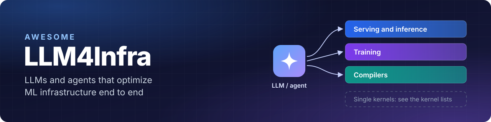

{{badges}}

Papers and reports in which **LLMs and LLM-based agents optimize machine-learning infrastructure end to end**: 
serving engines, training frameworks, ML compilers, and the configuration and communication around them.

## 📚 Contents

{{overview}}

Also: [🔥 Most recent](#-most-recent) · [🔗 Related lists](#-related-lists) · [🤝 Contributing](#-contributing)

## 📌 Scope

✅ **Included:** an LLM or an LLM-based agent does the optimizing, and the thing optimized or evaluated sits above a single kernel: end-to-end inference or training performance, serving and training frameworks, ML compilers, configuration for ML workloads, and benchmarks for these tasks. Kernel work is included when its gain is measured end to end in a real framework.

❌ **Not included:** single-kernel generation and optimization (see the [related lists](#-related-lists)), infrastructure built for agents, ML systems designed without an LLM in the loop, and general software or systems optimization that does not target ML infrastructure. [CONTRIBUTING.md](CONTRIBUTING.md) has the full rule.

> [!NOTE]
> Results are quoted as each paper's authors report them. Settings differ, so numbers are not comparable across entries.

## 🔥 Most recent

{{recent}}

{{sections}}
## 🔗 Related lists

- Kernel generation and optimization with LLMs: [Awesome-LLM4Kernel](https://github.com/kcxain/Awesome-LLM4Kernel), [Awesome-LLM-Kernel-Agent](https://github.com/qhy991/Awesome-LLM-Kernel-Agent), [awesome-kernel-agent](https://github.com/youyve/awesome-kernel-agent).
- LLM systems in general, designed by people or by LLMs: [LLMSys-PaperList](https://github.com/AmberLJC/LLMSys-PaperList).

## 🤝 Contributing

Add one TOML file under `data/` and open a pull request. [CONTRIBUTING.md](CONTRIBUTING.md) describes the format and what qualifies.
